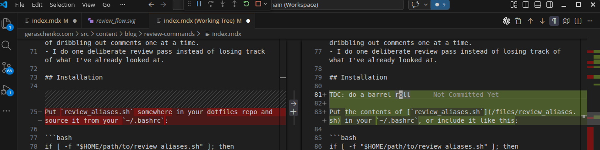

import RenderDAG from '@components/RenderDAG.astro';

I've been using two little shell functions to help me work with AI coding assistants: `review_start` and `review_done`. They let me do a full review pass in my editor, leave inline comments and fixes, and then hand the agent a commit containing _just_ my feedback.

## TL;DR
Add `review_start` and `review_done` to your `~/.bashrc` (see [below](#installation)), then use this workflow:

```bash
# Have the agent implement feature XYZ
review_start "implemented XYZ"
# Review in your editor, making whatever changes you like
review_done
# Tell the agent to run `git show HEAD`. It will see just *your* changes.
```

## The idea

`review_start "implemented XYZ"` does three things:

1. commits outstanding changes on your current branch,
2. creates a temporary review branch (`review__my-feature` if you were on `my-feature`),
3. resets that branch back one commit while keeping the changes in your working tree.

So the agent's work is persisted as a commit, but in your editor it still looks like ordinary uncommitted changes. The resulting history is roughly:

<RenderDAG parents="below" nodes={[
  { id: 'R', glyph: '│', message: 'the changes from D, uncommitted (<code>HEAD -&gt; review__my-feature</code>)', parents: ['C'] },
  { id: 'D', message: 'D: implemented XYZ (<code>my-feature</code>)', parents: ['C'] },
  'C',
  'B',
  'A',
]} />

Here `D` is the snapshot commit. The review branch points at `C`, but your working tree still contains the diff from `D`, so you can review it naturally in your IDE (Ctrl+Shift+G in VS Code). While reviewing, I often:

- edit code directly,
- leave inline temporary comments like `TDC: factor this out into a helper`,
- ask questions like `TDC: why did you do X here?`

("`TDC`" is just a unique string I use, originally meaning "TODO(Claude/Codex)". When I finish my review iterations, I want there to be no instances of "TDC: " in the codebase.)



When I'm done, I run `review_done`. That switches back to the original branch (preserving working tree state), deletes the temporary review branch, and creates a new commit containing only my edits:

<RenderDAG parents="below" nodes={[
  { id: 'E', message: 'E: review feedback (<code>HEAD -&gt; my-feature</code>)', parents: ['D'] },
  { id: 'R', glyph: '│', message: '<span style="opacity: 0.5">same tree state as E (was <del><code>review__my-feature</code></del>)</span>', parents: ['C'] },
  { id: 'D', message: 'D: implemented XYZ', parents: ['C'] },
  'C',
  'B',
  'A',
]} />

Then I tell the agent something like "Good work. `git show <hash-for-E>` to see my feedback." If you're in tmux, `review_done` copies E's hash to the paste buffer, so typing it is just `prefix ]` (`C-b ]` by default).

These snapshot and feedback commits are scaffolding for the conversation with the agent. Once the work is done, I squash them into a single commit so the final history shows the feature, not the back-and-forth.

## Why I like this

It turns "please address my review comments" into a concrete Git object.

- My requests are right next to the code I was looking at when I made the request.
- The agent can see what I already changed, so it is less likely to revert my manual fixes.
- It is token-efficient: I can supply the review commit in a single conversational turn instead of dribbling out comments one at a time.
- I don't lose track of what I've already looked at, and the code doesn't change under my feet while I'm reviewing it.

You can get some of this from a code review tool, but I like to review diffs in my IDE because that's how I'm used to navigating code. I can jump between files, jump to definition, list all occurrences of a symbol, and so on. Having all that at my fingertips makes a diff much easier to digest, and pushing to a review tool and opening a web page feels clunky by comparison. Even when I review other people's code, I often prefer to pull their branch so I can review and mess with it locally.

Leaving the changes uncommitted and unstaged is what lets me _edit_ them. My IDE will happily show me the diff of a commit, or of staged changes, but that view is read-only.

## Installation

Put the contents of [`review_functions.sh`](/files/review_functions.sh) in your `~/.bashrc`, or include it like this:

```bash
if [ -f "/path/to/review_functions.sh" ]; then
  . "/path/to/review_functions.sh"
fi
```

Then reload your shell:

```bash
source ~/.bashrc
```

## Notes and caveats

- The current version uses `git commit -am ...`, so it handles tracked modified/deleted files but not new untracked files. If the agent created new files, `git add` them first.
- `review_done` expects you to still be on the review branch; it finds the original branch by stripping the `review__` prefix.
- You can have one review in progress per branch, so separate worktrees can each review at the same time.